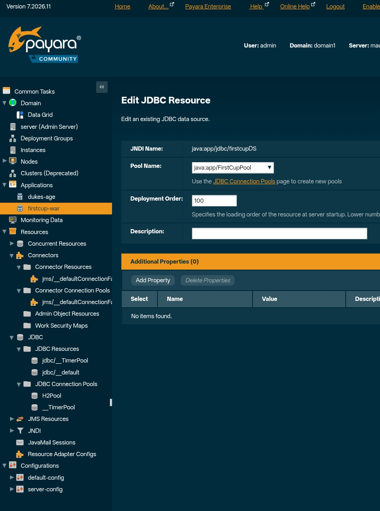
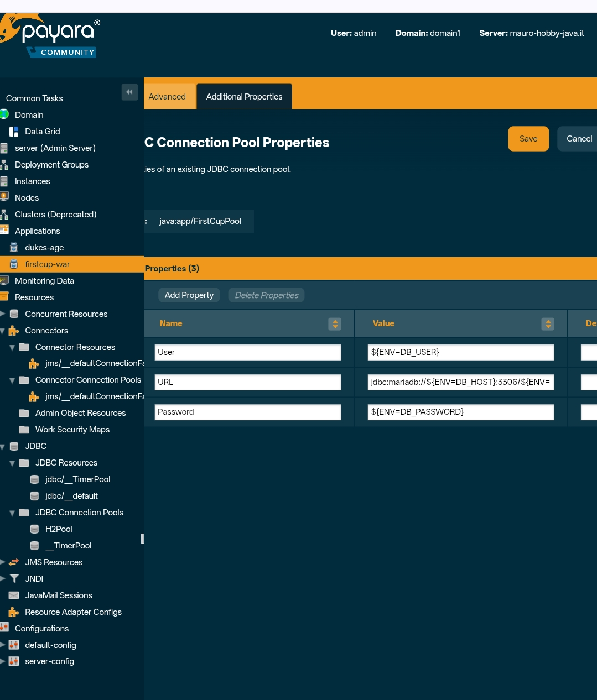

# Jakarta EE First Cup — Payara 7 & MariaDB (Docker)

Ambiente containerizzato per il deployment automatico delle applicazioni **Jakarta EE First Cup** (`firstcup-war.war` e `dukes-age.war`) su **Payara Server 7 Full**, collegato a un database **MariaDB 10.11** e gestibile via web tramite **Adminer**.

---

## 🛠️ Architettura e Servizi

Lo stack è orchestrato tramite `docker-compose.yml` su una rete bridge dedicata (`app-net-full`) e comprende tre container:

| Servizio | Container | Immagine | Porte Mappate (Host:Container) | Descrizione |
| :--- | :--- | :--- | :--- | :--- |
| **payara-app** | `firstcup-payara` | `payara/server-full:latest` | `6680:8080` (HTTP)<br>`6648:4848` (Admin) | Application server Jakarta EE con autodeploy automatico da `./webapps`. |
| **db** | `firstcup-mariadb` | `mariadb:10.11` | `3306` (interna) | Database relazionale con volume persistente `mariadb_data_full`. |
| **adminer** | `firstcup-adminer` | `adminer:latest` | `6699:8080` | Interfaccia web leggera per l'amministrazione di MariaDB. |

---

## 📁 Struttura della Directory

```text
payarafull/
├── docker-compose.yml       # Definizione dei servizi, reti e volumi
├── .env                     # Variabili d'ambiente (credenziali DB e Payara)
├── docs/                    # Screenshot per la documentazione
│   ├── jdbc-datasouce-.jpg
│   └── valori-datasource.jpg
├── webapps/                 # Cartella mappata su /opt/payara/deployments
│   ├── dukes-age.war        # Servizio REST per il calcolo dell'età di Duke
│   └── firstcup-war.war     # Applicazione web principale (localizzata in IT)
└── README.md                # Documentazione del progetto
```

---

## ⚙️ Configurazione (`.env`)

Prima di avviare lo stack, assicurati che nella stessa cartella di `docker-compose.yml` sia presente il file `.env` con le seguenti variabili:

```env
# Configurazione Database MariaDB
DB_ROOT_PASSWORD=la_tua_password_root
DB_NAME=firstcup
DB_USER=firstcup_user
DB_PASSWORD=la_tua_password_utente

# Credenziali Amministratore Payara
PAYARA_ADMIN_USER=admin
PAYARA_ADMIN_PASSWORD=la_tua_password_payara
```

---

## 🗄️ Configurazione DataSource e Variabili d'Ambiente

La connessione tra l'applicazione `firstcup-war` e MariaDB viene configurata automaticamente al momento del deploy tramite il file `glassfish-resources.xml` incluso nel pacchetto WAR:

```xml
<?xml version="1.0" encoding="UTF-8"?>
<!DOCTYPE resources PUBLIC "-//GlassFish.org//DTD GlassFish Application Server 3.1 Resource Definitions//EN" "http://glassfish.org/dtds/glassfish-resources_5_0.dtd">
<resources>
    <jdbc-resource pool-name="FirstCupPool" 
                   jndi-name="java:app/jdbc/firstcupDS"/>
    
    <jdbc-connection-pool name="FirstCupPool"
                          datasource-classname="org.mariadb.jdbc.MariaDbDataSource"
                          res-type="javax.sql.DataSource">
        <property name="URL" value="jdbc:mariadb://${ENV=DB_HOST}:3306/${ENV=DB_NAME}"/>
        <property name="User" value="${ENV=DB_USER}"/>
        <property name="Password" value="${ENV=DB_PASSWORD}"/>
    </jdbc-connection-pool>
</resources>
```

### Verifica nella Console di Amministrazione di Payara

Accedendo alla Console di Amministrazione (`https://<IP_VPS>:6648`), sotto la voce **Applications → firstcup-war**, è possibile verificare che Payara abbia registrato correttamente la risorsa JNDI e i parametri del Connection Pool letti dal container Docker:

1. **Risorsa JDBC (`java:app/jdbc/firstcupDS`) collegata al pool `java:app/FirstCupPool`:**
   

2. **Proprietà del Connection Pool con i segnaposto `${ENV=...}` risolti dinamicamente da `docker-compose.yml`:**
   

---

## 🚀 Avvio e Gestione

### 1. Avvio dello stack (con autodeploy automatico)
Posiziona i file `.war` compilati nella cartella `./webapps` (assicurandosi che non siano presenti cartelle residue `.autodeploystatus`) e avvia i container:

```bash
docker compose up -d
```

All'avvio, lo script di entrypoint di Payara rileva automaticamente gli archivi presenti in `./webapps` e li aggiunge ai comandi di post-boot senza bisogno di interventi manuali.

### 2. Verifica dei log di deployment
Per monitorare l'avvio di Payara e confermare l'avvenuto deploy delle applicazioni:

```bash
docker compose logs -f payara-app
```

### 3. Arresto e pulizia completa
Per fermare i container (aggiungere `-v` solo se si desidera cancellare anche i volumi del database):

```bash
docker compose down
```

---

## 🌐 Accesso ai Servizi

Sostituisci `<IP_VPS>` con l'indirizzo IP pubblico del server o con il dominio associato:

* **Applicazione First Cup:** `http://<IP_VPS>:6680/firstcup-war`
* **Servizio Duke's Age:** `http://<IP_VPS>:6680/dukes-age`
* **Console di Amministrazione Payara:** `https://<IP_VPS>:6648` *(accedere con `<PAYARA_ADMIN_USER>` e `<PAYARA_ADMIN_PASSWORD>`)*
* **Adminer (Gestione DB):** `http://<IP_VPS>:6699`
  * **Sistema:** `MySQL`
  * **Server:** `db`
  * **Utente:** `<DB_USER>`
  * **Password:** `<DB_PASSWORD>`
  * **Database:** `<DB_NAME>`